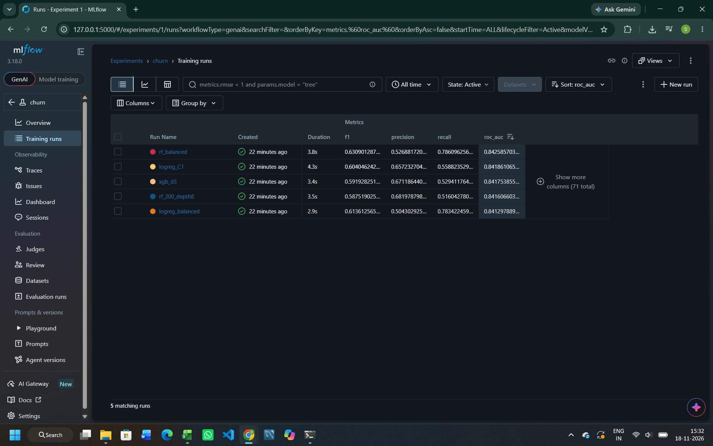

Predicts whether a telecom customer will leave, using the Telco Customer Churn
dataset from Kaggle. Download the CSV from Kaggle and place it in `data/`.

## Results

| Model | F1 | Recall | ROC-AUC |
|---|---|---|---|
| Logistic Regression | 0.604 | 0.559 | 0.842 |
| Logistic Regression (balanced) | 0.614 | 0.783 | 0.841 |
| Random Forest | 0.588 | 0.516 | 0.842 |
| Random Forest (balanced) | 0.631 | 0.786 | 0.843 |
| XGBoost | 0.592 | 0.529 | 0.842 |

Chosen model: Random Forest (balanced). Missing a customer who is about to leave
costs more than a false alarm, so recall was prioritised.

## Tech stack
Python, scikit-learn, XGBoost, MLflow

## Coming next
FastAPI service, Docker, GitHub Actions CI, deployment
